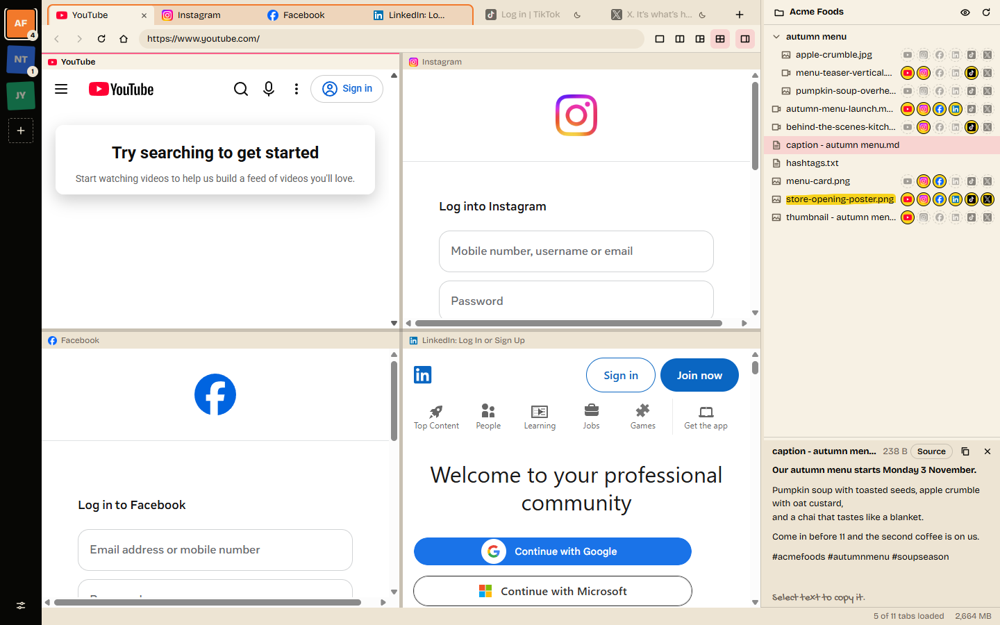
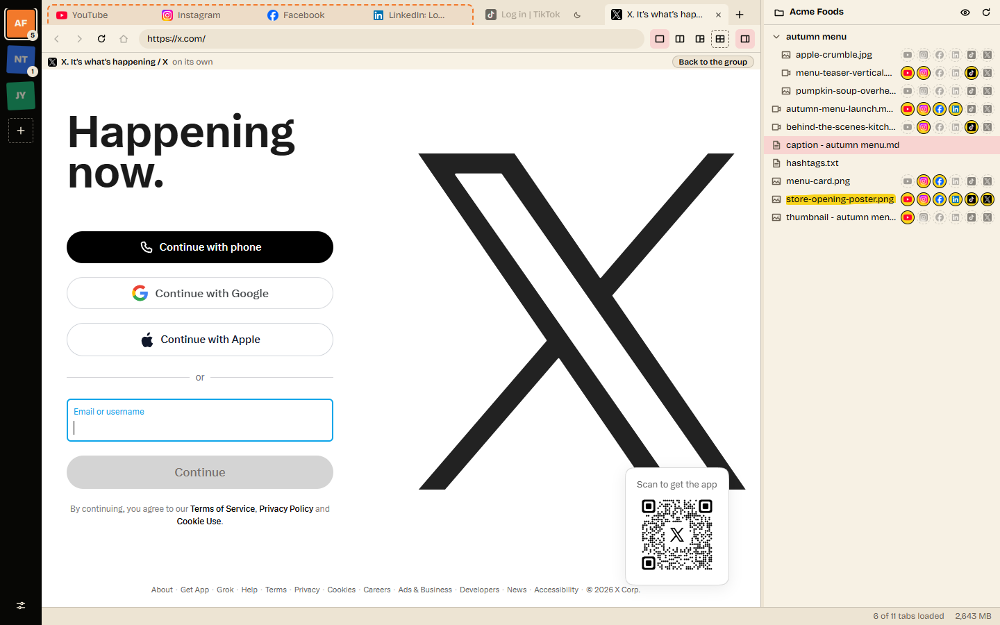
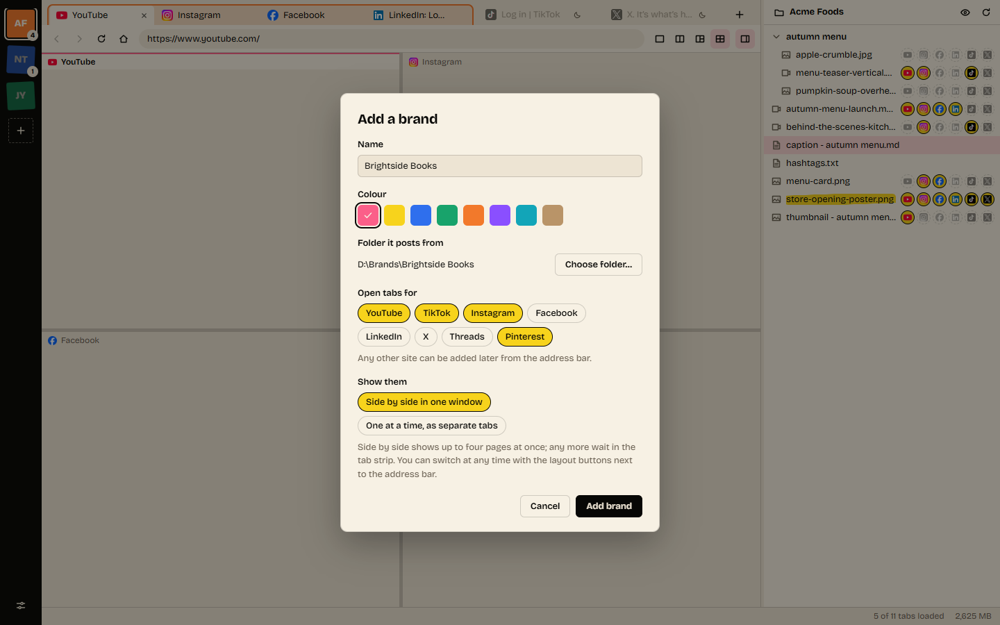
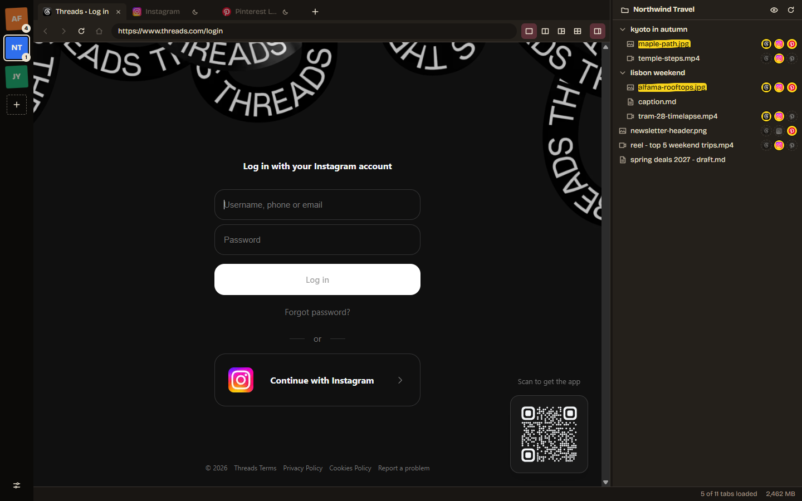

<p align="center">
  <a href="https://thedumbstuff.page/"></a>
</p>

<p align="center">
  <b>Brought to you by <a href="https://thedumbstuff.page/">thedumbstuff</a></b><br>
  A small collection of ridiculous ideas. This is one of them.
</p>

<p align="center">
  <i>We were posting one video to six websites from a browser with forty tabs,<br>
  signed in as the wrong brand in at least two of them.<br>
  A sensible person would have hired someone. We built an app.</i>
</p>

<p align="center">
  Yes, it is a browser for people who already have a browser. We are aware.<br>
  No, it does not post for you. The platforms forbid that, and we would like to keep our accounts.<br>
  It puts everything in one window and stays out of the way.
</p>

---

<p align="center">
  
</p>

<h1 align="center">fanout</h1>

<p align="center">
  <b>One window for every brand's social accounts.</b><br>
  Each brand keeps its own sign-ins, its own tabs and its own folder of things to post.
  Put up to four sites side by side, drag the video from the folder onto each one, and tick off where it went.
</p>

<p align="center">
  No download yet: for now the Windows installer is built from the source (<a href="#build-an-installer">below</a>).
  Downloads on <a href="https://thedumbstuff.page/">thedumbstuff.page</a> are coming. macOS and Linux are untested.
</p>

<p align="center">
  
</p>

> The screenshots show sample data: made-up brands and files, and each site's public
> page, signed out. fanout is not affiliated with or endorsed by any of the platforms shown.

---

## Why

Posting the same video to YouTube, LinkedIn, TikTok and the rest means a pile of
browser tabs, and with more than one brand it means signing out and in again all day.
fanout keeps each brand in its own compartment:

- **Brands**, each with its own sign-ins. The same site can be signed in to a different
  account in every brand, and stays signed in.
- **Tabs per brand** for the places it posts. Any address works; nothing in fanout is
  specific to a platform.
- **Up to four pages side by side**, with dividers you drag. Each brand remembers its
  layout and which page is in which pane. Other tabs open on their own in front of
  that group and never push a page out of it; a tab joins the group only when you say so.
- **A file panel per brand**, pinned to the folder that brand posts from. Drag a file
  onto any page that accepts uploads, exactly as you would from Explorer or Finder.
- **Caption files open in place.** Click a text file (`.txt`, `.md` and the like) to
  read it; select any part of the text and it is copied. Markdown is shown formatted
  (Source shows it as written), and what you copy from it is plain text, ready for a
  caption box.
- **A posted tracker.** Tick which file has gone where; hide what is posted everywhere.
- **It updates itself**, once downloads are on thedumbstuff.page: new versions download
  in the background and install when you restart or close it. (On macOS, until fanout
  is signed, it says a new version is out and opens the download page.)
- **Tabs you are not using go to sleep** and give their memory back. A tab that is
  uploading, playing sound or holding something you typed is left alone.

fanout does not post for you. It never clicks, types or reads inside a page, because
most platforms forbid automated activity. You upload by hand; fanout removes the
juggling around it.

## A closer look

<table>
  <tr>
    <td width="50%"></td>
    <td width="50%"></td>
  </tr>
  <tr>
    <td><b>A tab on its own</b> - a tab outside the group fills the page area; the group waits, outlined, one click away.</td>
    <td><b>Add a brand</b> - a name, a colour, the folder it posts from, and the sites it posts to.</td>
  </tr>
  <!-- The media viewer's picture (assets/screenshots/viewer.png, from tools/screenshots.mjs)
       goes in the row below, as its own 50% cell beside posted-dark.png, once the viewer is on main. -->
  <tr>
    <td colspan="2"></td>
  </tr>
  <tr>
    <td colspan="2"><b>Posted tracker</b> - a mark per file and site, set by hand; a file that has gone everywhere is highlighted. Light and dark themes follow the system.</td>
  </tr>
</table>

## Run it

Windows: double-click `Open fanout.bat` (it installs what it needs the first time).

Any system, with Node.js 22 or newer:

```
npm install
npm start
```

## Build an installer

```
node tools/release.mjs build  # for the system you are on
```

The result is in `dist/`. The workflow in `.github/workflows/build.yml` is set up to
build Windows, macOS and Linux installers; it has not run yet. The installers are not
code signed yet, so Windows and macOS warn before the first run.

## Develop

```
npm test             # unit tests, no Electron needed
npm run smoke        # the real app against a throwaway profile; opens a window
npm run measure      # memory with six real sites loaded, then with five asleep
npm run screenshots  # the pictures in this README, from the real app; opens a window
python watchtower/server.py    # build dashboard on http://127.0.0.1:8768
```

Start with `src/main/main.js`; it lists what every file is for. More in `docs/`:
[architecture](docs/architecture.md), [memory](docs/memory.md),
[gotchas](docs/gotchas.md), [updates](docs/updates.md), [changelog](docs/changelog.md).
`tools/screenshots.mjs` says at its top how the pictures are made and what is in them.

## Where your data is

Brands, tabs and posted marks are two JSON files in the app's data folder
(`%APPDATA%\fanout` on Windows, `~/Library/Application Support/fanout` on macOS,
`~/.config/fanout` on Linux), next to each brand's browser profile. Nothing in them is
sent anywhere. Deleting a brand signs it out everywhere and removes its profile; the
files in its folder are never touched.

MIT licence. Made by [thedumbstuff](https://thedumbstuff.page).
